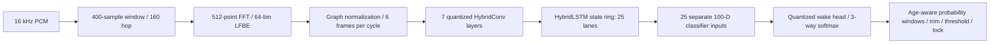
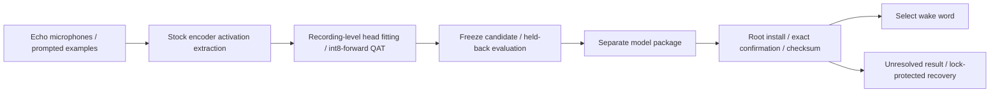

# Pryon: reconstructing an embedded wake-word engine

**828 of 828 evaluated audio-feature frames matched the genuine Pryon runtime bit-for-bit at its normalized
first-convolution input: 64 bins per frame, maximum absolute error 0.** This is a finite, build-specific result,
rechecked against retained captures during release preparation—not a claim that every operator or utterance is exact.
[Setup, evidence boundaries and unsuccessful hypotheses](docs/EVIDENCE.md).

This is BenStein1's independently implemented reconstruction and training research for the Echo Dot 3's NemoRT ONNX
inference engine. The problem was not opening an ONNX file: its `HybridConv`, `HybridLSTM` and `HybridGemm` operators,
quantization, audio frontend and streaming decoder had to agree with an opaque native library. A small rounding change
could move an int8 code, then amplify through recurrent state or training into a different detection.

The work connects embedded C, DSP, numerical reverse engineering, neural-network inference, quantization-aware
training, reproducible synthetic tests, and recovery engineering on real hardware. Research direction and device
experimentation are Ben's; implementation and analysis were developed with AI assistance. It is binary-informed
reverse engineering, not a clean-room implementation or Amazon source code.

## What was reconstructed



The wake branch's 25 representations remain separate. Training uses recording-level supervision and three-age
probability windows; flattening them into independent examples would lose the measured streaming behavior.
See [architecture and source map](docs/ARCHITECTURE.md).

| Evidence | Result | What it establishes |
|---|---|---|
| Retained genuine-runtime capture, reanalyzed | **828 × 64 normalized features bit-exact** | Frontend parity at one measured boundary/build |
| Historical quantized streaming comparison | LSTM input max error 1.07e-6 over 133 cycles; classifier input <2.4e-6 after cycle 30; wake softmax <1.8e-7 | Close numerical behavior on those captures, not universal equivalence |
| Historical kernel checks on stock inputs | Conv2–7 bit-exact in the documented comparison | Kernel arithmetic agreement with supplied stock inputs, not arbitrary full-stream parity |
| Portable C math oracle | FNV-1a `96594667583f1fd3` | Fixed deterministic `exp/log/log1p` regression against the recorded device oracle |
| Public synthetic suite | 32 tests + C math check pass | Algorithm contracts, gradients, source-preserving export and training lifecycle; no speech-quality claim |
| Physical Dot 3 | On-device training prototype; later isolated root install/confirmation/recovery and stock inference | Feasibility and tested state transitions; not production readiness |

Only the first row was freshly reanalyzed against retained genuine-runtime feature data during this release pass.
The exact reviewed snapshot also passed [hosted synthetic CI](https://github.com/BenStein1/pryon-research/actions/runs/43215812663).
The public tests contain synthetic weights/signals only. Historical captures, model weights and recordings are not
published. [Exact validation scope](docs/VALIDATION.md).

## Run a one-minute demonstration without firmware

Python 3.12, a C compiler, and the listed Python packages are sufficient. No Echo, microphone or model download:

```sh
python3 -m venv .venv
.venv/bin/python -m pip install -r requirements.lock.txt
make test PYTHON=.venv/bin/python
make demo PYTHON=.venv/bin/python
```

The demo builds a synthetic DSP input, trains an int8-forward classifier on synthetic 25-lane sequences, and exercises
the temporal decoder with constructed probabilities. It does **not** execute a vendor encoder or recognize a phrase.
The fixed demonstration reduces quantized training loss from about 1.41205 to 0.0365353 and emits one constructed
decoder accept. [Output](docs/DEMO_OUTPUT.json) · [reproduction and private-capture checks](docs/REPRODUCING.md).

## From research to the Echo



The actual web enrollment, installer and recovery feature lives in
[Ben's echo-dot-assist fork](https://github.com/BenStein1/echo-dot-assist), proposed upstream in
[training PR #172](https://github.com/Gamer92000/echo-dot-assist/pull/172). The companion
[reconstruction PR #171](https://github.com/Gamer92000/echo-dot-assist/pull/171) contains supporting research tools.
Their status was checked during release preparation; neither had merged. This standalone source-only release is now
published here; the reviewed initial snapshot is commit `88487e5`.

The Home Assistant satellite, Echo integration and platform were built by
[Julian Imhof / Gamer92000](https://github.com/Gamer92000/echo-dot-assist); hardware unlock work belongs to its credited
authors, including R0rt1z2. Ben's contribution is the subsequent Pryon investigation, reconstruction, custom training
and recovery feature. Those distinctions and dependency licenses are preserved in [AUTHORS.md](AUTHORS.md).

## Limits and release boundary

A quantized head that fits a few recordings can still falsely accept ordinary speech. QAT improved synthetic/training
objectives but did not establish arbitrary-phrase reliability; small recording-grouped validation studies remained
unsatisfactory. Some alleged library defects were instead reproduced in the genuine runtime as classifier
false accepts. Generalization across phrases, speakers, rooms and continuous everyday audio remains unproven.

No original Amazon/Pryon binaries, model weights, generated candidate models, speech recordings, private datasets,
device identities, internal addresses, or private research history are included. To compare against genuine Pryon,
provide your own local assets; do not commit them. Redistribution rights for those assets are not established.
[Asset/license review](docs/RELEASE_REVIEW.md) · [exact publication inventory](RELEASE_CONTENTS.json).
